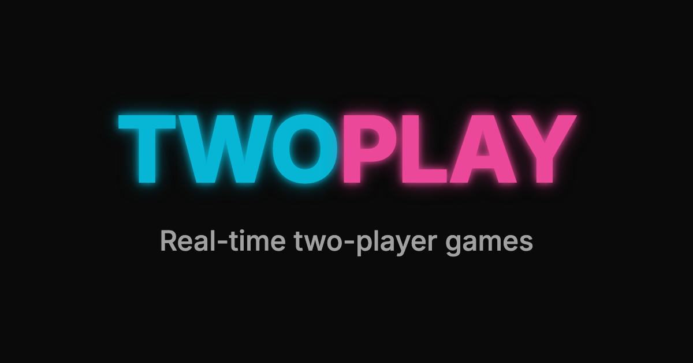
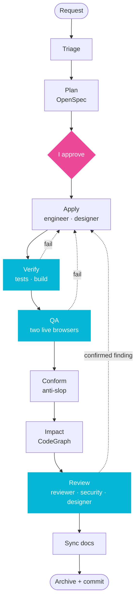
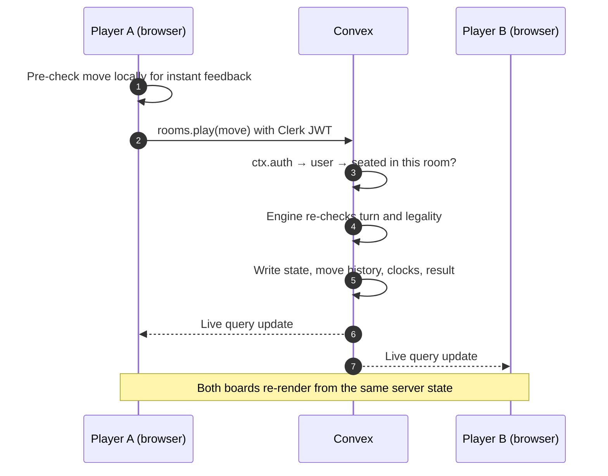
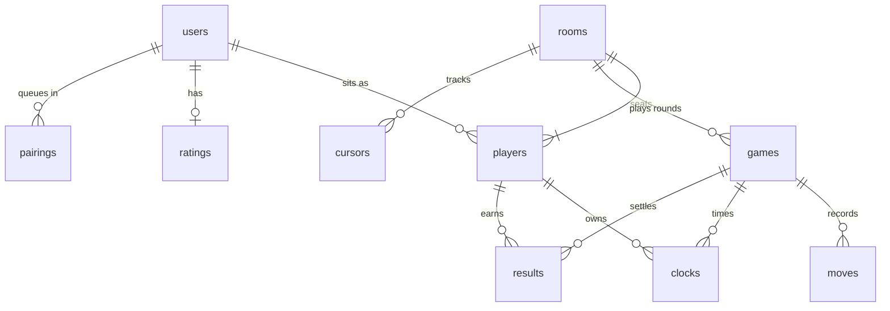
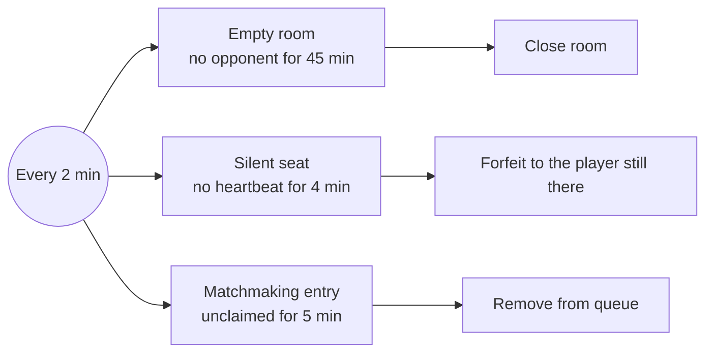
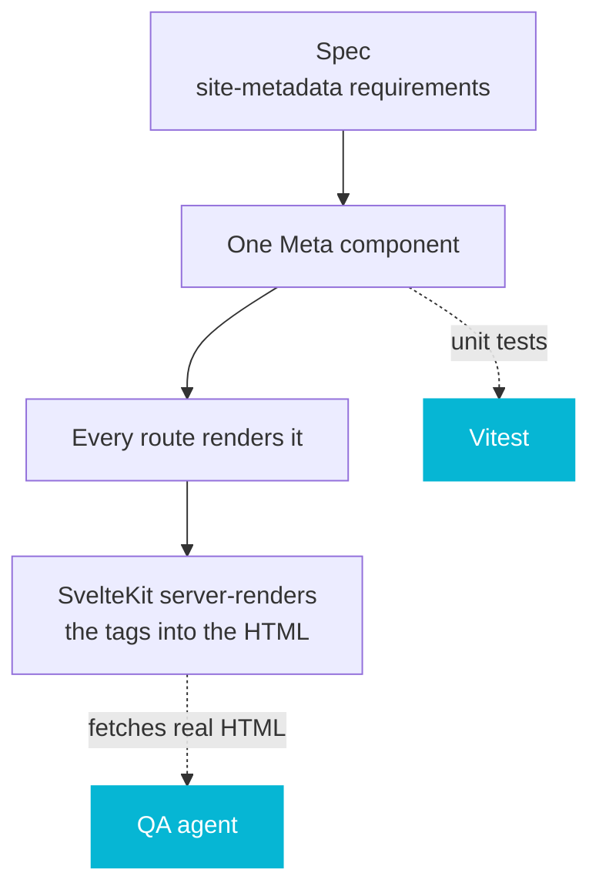

<div align="center">



**Real-time two-player games, built by a team of AI agents with one engineer in charge.**

[](https://svelte.dev)
[](https://svelte.dev)
[](https://www.typescriptlang.org)
[](https://convex.dev)
[](https://clerk.com)
[](https://tailwindcss.com)
[](https://vitest.dev)
[](https://claude.com/claude-code)

</div>

---

## Highlights

|                                              |                                                                                                                                               |
| -------------------------------------------- | --------------------------------------------------------------------------------------------------------------------------------------------- |
| 🤖 **A nine-agent dev team**                 | One command takes a request through triage, spec, build, tests, live QA, review, and commit. [→](#the-agentic-workflow)                       |
| 🧭 **I stayed in control**                   | I approve every plan. Reviewers can't edit, builders can't approve themselves, and agents never push or deploy. [→](#the-team)                |
| 🔀 **A new stack, shipped**                  | A React developer shipping SvelteKit, Svelte 5, and Convex. The stack isn't the limit, judgment is. [→](#a-react-developer-walks-into-svelte) |
| 📜 **Spec-driven**                           | Every behavior is a written scenario first, and every scenario needs a test or code path before it ships. [→](#what-a-spec-looks-like)        |
| 🧪 **860+ tests, plus live QA**              | Vitest across backend, logic, and UI, and an agent that plays the game against itself in two browsers. [→](#engineering-practices)            |
| 🛡️ **The server decides**                    | Every move, clock, result, and rating is re-checked on the server. Every mutation checks auth and seat. [→](#design-principles)               |
| ⚡ **Real-time, no socket code**             | Moves, clocks, cursors, and the lobby sync live through Convex queries. [→](#one-move-start-to-finish)                                        |
| 📐 **Zero layout shift**                     | Measured by the QA agent on every route: a 0.1443 shift on room load, fixed to 0. [→](#case-study-one-real-change)                            |
| 🔍 **SEO by default**                        | One server-rendered `Meta` component on every page, tested and checked live. [→](#seo-without-thinking-about-it)                              |
| ♻️ **A process that improves itself**        | Every correction becomes a rule, and the workflow gets refactored like code. [→](#what-i-learned)                                             |
| 🎛️ **Right-sized process**                   | Five planning routes from "trivial" to "large and risky", plus a light lane for UI polish. [→](#the-agentic-workflow)                         |
| 🔎 **Skeptic-checked reviews**               | Every serious review finding is challenged by another agent before anyone fixes it. [→](#the-team)                                            |
| 🗺️ **Impact before edits**                   | CodeGraph lists every caller of a shared symbol before an agent changes it. [→](#engineering-practices)                                       |
| 🧹 **Anti-slop rules**                       | Agent code has no noise comments, no defensive clutter, no type escapes, and no AI-sounding copy. [→](#engineering-practices)                 |
| 📚 **Decisions on record**                   | 11 architecture decisions logged with the reason and what each one replaced. [→](#by-the-numbers)                                             |
| 🧠 **Knowledge that sticks**                 | After every change, an agent updates the project skills and docs so the next session starts smarter. [→](#the-team)                           |
| 🧩 **Game-agnostic core**                    | A new game is one server engine and one client class. Rooms, clocks, ratings, and replay come free. [→](#adding-a-game)                       |
| 🎲 **Games with a twist**                    | Nine-board tic-tac-toe where you can't replay your last board, and checkers with forced captures and multi-jumps. [→](#the-games)             |
| 🔁 **Replay for free**                       | Every move stores the full state after it, so scrubbing through a round needs no extra logic. [→](#data-model)                                |
| ⏱️ **A backend that cleans up after itself** | Crons close empty rooms, forfeit absent players, and clear the matchmaking queue every 2 minutes. [→](#the-system-takes-care-of-itself)       |
| 🏆 **Ratings and matchmaking**               | Find Match pairs waiting players, and every decisive round moves the leaderboard. [→](#how-to-play)                                           |
| ✨ **Live presence**                         | Opponent cursors, emoji trash talk, disconnect detection, and a background that reacts to the game. [→](#the-little-things)                   |
| 🔔 **Turn alerts**                           | In a background tab, the title flashes "Your turn" and an optional chime plays. Spectators never get pinged. [→](#what-a-spec-looks-like)     |
| ♿ **Accessible**                            | Focus rings at 3:1 contrast or better, full keyboard support, live regions, and reduced motion. [→](#engineering-practices)                   |
| 🎨 **Design tokens that can't drift**        | Seat colors are defined once, and a test keeps CSS and TypeScript in sync. [→](#engineering-practices)                                        |
| 🔐 **Secrets stay on the server**            | Clerk code is split into client and server, so secret-holding code never reaches the browser bundle. [→](#design-principles)                  |

## Quick links

| Section                                                                                                               | What's there                                                    |
| --------------------------------------------------------------------------------------------------------------------- | --------------------------------------------------------------- |
| **The project**                                                                                                       |                                                                 |
| [The short version](#the-short-version)                                                                               | What twoplay is and why it exists                               |
| [A React developer walks into Svelte](#a-react-developer-walks-into-svelte)                                           | Learning a new stack through agents, and React → Svelte mapping |
| [How to play](#how-to-play)                                                                                           | Five steps, the games, and the little features                  |
| [By the numbers](#by-the-numbers)                                                                                     | Agents, skills, tests, scenarios, decisions                     |
| **The workflow**                                                                                                      |                                                                 |
| [The agentic workflow](#the-agentic-workflow)                                                                         | The `/dev:work` pipeline and routes                             |
| [The team](#the-team)                                                                                                 | The nine agents and the rules between them                      |
| [What a spec looks like](#what-a-spec-looks-like)                                                                     | A real OpenSpec excerpt                                         |
| [Case study: one real change](#case-study-one-real-change)                                                            | What the agents found and fixed in a real change                |
| [What I learned](#what-i-learned)                                                                                     | Lessons on orchestration and control                            |
| **The system**                                                                                                        |                                                                 |
| [Architecture](#architecture)                                                                                         | Move flow, design principles, data model                        |
| [The system takes care of itself](#the-system-takes-care-of-itself)                                                   | Cron cleanup jobs                                               |
| [SEO without thinking about it](#seo-without-thinking-about-it)                                                       | Metadata, previews, manifest                                    |
| [Adding a game](#adding-a-game)                                                                                       | The steps to plug in a new game                                 |
| [Code tour](#code-tour)                                                                                               | Real snippets from the codebase                                 |
| **The rest**                                                                                                          |                                                                 |
| [Engineering practices](#engineering-practices) · [Tech stack](#tech-stack) · [Skills on display](#skills-on-display) | How it's built and with what                                    |
| [Repo tour](#repo-tour) · [What's next](#whats-next) · [Run it locally](#run-it-locally)                              | Where things live and how to start                              |

---

## The short version

twoplay is a live multiplayer game site: two twists on classic board games, played against another person in real time, with clocks, ratings, and a leaderboard.

What makes this project interesting isn't the games. It's how they were built. **twoplay is my first project built entirely with an agentic workflow.** I designed the system, the rules, and the quality bar. A team of nine specialized AI agents did the implementation, testing, reviewing, and QA, while I made the calls.

And I did it in a stack I barely knew.

## A React developer walks into Svelte

My day job is React. twoplay is SvelteKit, Svelte 5 runes, and Convex, none of which I had shipped before. I chose that on purpose.

With agents doing the typing, syntax stops being the bottleneck. What matters is what I've learned building software for years:

- where the trust boundary is, and what the server must re-check
- how to model data so the features stay simple
- what belongs in a shared base class and what stays per game
- how to test so a green run actually means something
- when the code looks like slop, even when it works

None of that depends on the framework. **This project is my proof that the stack isn't a limit anymore. Engineering judgment is the advantage, and it moves with me to any stack.**

<details>
<summary><b>How React ideas mapped to Svelte 5</b></summary>

<br/>

| In React I'd reach for…               | Here it's…                                              |
| ------------------------------------- | ------------------------------------------------------- |
| `useState`                            | `$state`                                                |
| `useMemo`                             | `$derived`                                              |
| `useEffect`                           | `$effect`, used sparingly                               |
| Context + provider                    | `setContext` / `getContext` with a typed `setupX()`     |
| Custom hook holding game state        | A class with rune fields (`TictactoeRoom extends Room`) |
| React Query / SWR                     | Convex live queries, pushed from the server             |
| Component library + `className` merge | shadcn-svelte + `tailwind-variants` + `cn`              |

The concepts carried over one to one. Only the syntax changed.

</details>

## How to play

1. Sign in and open **Play**.
2. Pick a game and a clock: 3, 5, or 10 minutes each.
3. Create a room and send the six-character code to a friend, or hit **Find Match** to get paired with someone waiting.
4. Play. Moves, clocks, and your opponent's cursor update live on both screens.
5. Rematch, look back over your **History**, or climb the **Leaderboard**.

Win, resign, run out of time, or walk away. Every result counts toward your rating.

### The games

|                 | The twist                                                                                                                                               |
| --------------- | ------------------------------------------------------------------------------------------------------------------------------------------------------- |
| **Tic-tac-toe** | Nine boards at once. You can't play the board you played last turn, so every move pushes you somewhere new. Win three boards in a row to win the round. |
| **Checkers**    | Classic rules, enforced by the server: mandatory captures, multi-jump chains, and kings.                                                                |

### The little things

- **Live cursors.** See where your opponent is hovering while they think.
- **Emoji trash talk.** Fire an emoji at your opponent mid-game.
- **Turn alerts.** Tab in the background? The title flashes "Your turn" and an optional chime plays.
- **Ambient mood.** The background reacts to how the game is going.
- **Replay.** Scrub back through every move of the round.
- **Presence.** You'll know when your opponent has disconnected.
- **Rating.** Everyone starts at 400. Each decisive round moves you 8 points, and draws don't count.

## By the numbers

|          |                                                     |
| -------- | --------------------------------------------------- |
| **9**    | specialized agents, each with one job               |
| **31**   | skills: project knowledge, stack guides, process    |
| **860+** | Vitest tests across backend, logic, and UI          |
| **122**  | spec scenarios in a single UI polish change         |
| **11**   | logged architecture decisions, each with its reason |
| **2**    | real browsers the QA agent plays itself in          |
| **1**    | command to take a request from idea to commit       |
| **0**    | moves the server trusts without checking            |

## The agentic workflow

Everything goes through one command: `/dev:work <request>`. Bug, feature, or refactor, it follows the same path.



The pink step is me. The blue ones are gates the code has to pass. Fix loops have hard limits, so a stuck change stops and asks instead of spinning forever.

Not every change needs the same ceremony. Triage recommends a route:

| Route     | When                                         |
| --------- | -------------------------------------------- |
| `none`    | Trivial. No behavior change.                 |
| `explore` | The problem or the approach is still unclear |
| `propose` | Clear goal, but with open questions          |
| `ff`      | Clear scope, plan everything in one go       |
| `new`     | Large or risky, review each artifact in turn |

### The team

<details>
<summary><b>Meet the nine agents</b></summary>

<br/>

| Agent       | Job                                                    | Can edit code    |
| ----------- | ------------------------------------------------------ | ---------------- |
| `triage`    | Classifies and sizes a request, maps what it touches   | No               |
| `architect` | Writes the OpenSpec change: proposal, specs, tasks     | `openspec/` only |
| `engineer`  | Convex functions, game engines, data flow              | Yes              |
| `designer`  | UI, Tailwind, accessibility                            | Yes              |
| `steward`   | Keeps conventions, architecture, and docs consistent   | Behavior-safe    |
| `verifier`  | Runs tests, type check, and build, maps specs to tests | No               |
| `qa`        | Signs in as two players and plays the real app         | No               |
| `reviewer`  | Correctness, spec match, conventions                   | No               |
| `security`  | Auth and the server trust boundary                     | No               |

</details>

The rules that make it trustworthy:

- **Separation of powers.** Reviewers can't edit. Builders don't approve their own work.
- **Skeptic pass.** A review finding is checked by another agent before anyone fixes it, which filters out false alarms.
- **Real QA.** The `qa` agent runs two Chrome profiles, signs in as Alex and Blair, and plays actual games against itself over Chrome DevTools MCP.
- **Spec as contract.** Every scenario in the spec has to map to a test or a code path before the change can be archived.
- **Knowledge that sticks.** After every change, the `steward` agent updates the project skill files and the decisions log, so the next session starts smarter.

### What a spec looks like

Every behavior is written down before it's built. This is a real excerpt from the turn-alert spec:

```markdown
### Requirement: Detect the viewer's turn arriving

The alert SHALL fire only on a transition from not-the-viewer's-turn to the
viewer's turn in the live round while the tab is hidden.

#### Scenario: Opponent moves while tab hidden

- **WHEN** the viewer is seated, the tab is hidden, and the turn passes to the viewer
- **THEN** the alert fires once

#### Scenario: Spectator

- **WHEN** a spectator's tab is hidden and the turn changes
- **THEN** no alert fires
```

Each scenario becomes a test. If a scenario has no evidence, the change doesn't ship.

Full details: [WORKFLOW.md](WORKFLOW.md) · agent definitions in [.agents/](.agents/)

## Case study: one real change

`polish-app-shell` was a pass over navigation, metadata, accessibility, toasts, turn alerts, and layout stability. Here's what the workflow did with it.

|                        |                                                                    |
| ---------------------- | ------------------------------------------------------------------ |
| Capabilities specified | 11 (navigation, auth, tokens, layout stability, a11y, metadata, …) |
| Scenarios              | 122                                                                |
| Tasks                  | 164                                                                |
| Viewports measured     | 360×640 and 1280×800, signed in and out, every route               |

**What the agents found.** The `qa` agent measured Cumulative Layout Shift on every route, signed in and signed out, as Alex and Blair in two browsers. It found problems I wouldn't have caught by eye:

- Opening a game room shifted the layout by **0.1443** on mobile while the board replaced a spinner.
- An auth error banner pushed the page down by 42px.
- Swapping in the web font nudged header links by 3px.
- The opponent's live cursor caused tiny shifts because it was positioned with `left`/`top` instead of a transform.

**After the fixes:** the final QA pass measured **0** layout shift on every route at both viewports, signed in and signed out, across real tic-tac-toe and checkers games.

**What it taught me about the process.** That change ran on the heaviest route, with a spec revision for every piece of feedback and repeated two-browser QA. The overhead dwarfed the edits. So I added a **polish lane**: plan in one go, one designer owns the area, feedback in one batch, one QA run at the end. The workflow got the same treatment as the code: measure, find the bottleneck, refactor.

## What I learned

> The job shifted from writing code to designing the system that writes it, and deciding what "good" means.

- **Orchestration beats prompting.** A single prompt doesn't build a product. A pipeline of narrow agents with clear inputs and outputs does.
- **Control lives in the process, not the chat.** Specs, rules, and gates keep the agents on track better than correcting them message by message.
- **Spec first.** Code gets checked against written requirements, not a half-remembered request.
- **Evidence before "done".** An agent saying "fixed" means nothing until tests, types, and a live browser agree.
- **Give agents a map.** CodeGraph gives agents symbol-level context and blast radius before they edit, instead of grepping and guessing.
- **Every correction becomes a rule.** When I corrected something once, it went into the decisions log or a skill so no agent made that mistake again.
- **Visibility matters.** I first ran checks as background workflows and couldn't tell what was happening. Now every step is a visible agent with a start and end marker.
- **The process is code too.** I refactor the workflow the same way I refactor the app.

## Architecture

### One move, start to finish



### Design principles

- **The server decides.** Each game is written twice: a Convex engine that validates every move, turn, outcome, clock, and rating change, and a client mirror so the UI feels instant. The client only proposes.
- **Auth in every handler.** Identity comes only from `ctx.auth`, and every mutation checks the caller holds a seat in that room. No middleware to forget about.
- **Game-agnostic core.** Rooms, clocks, results, move history, rematches, and replay don't know which game is running. A new game is one `GameEngine` on the server and one `Room` subclass on the client.
- **Real-time everywhere.** Convex live queries drive the board, clocks, lobby, and presence cursors. No polling, no socket code to maintain.
- **Strict structure.** Code is grouped by category (`components/ui`, `features/play`, `utils/style`, `services/auth`), each with its own barrel and no wildcard exports. Server-only auth code is split out so secrets never reach the browser.

### Data model



A player row exists per user per room, so names, scores, and emoji are snapshots of that room. Each round is a new `games` row, and every move stores the full state after it, which is what makes replay free.

### The system takes care of itself

Convex crons run every 2 minutes so nobody has to clean up after a game:



### SEO without thinking about it

SEO isn't a checklist someone has to remember. It's built into how pages are made, and the workflow checks it on every change.



- **One component, every page.** All 7 routes render `<Meta>`. It builds the `Page · twoplay` title, the description, and the Open Graph tags (`og:title`, `og:description`, `og:type`, `og:image`) from two props.
- **Hard to forget.** `description` is a required prop, so a page without one fails the type check.
- **Server-rendered.** SvelteKit renders the tags into the HTML, so crawlers and link previews see them without running JavaScript.
- **Share previews work.** `og:image` is built as an absolute URL from the request origin, which crawlers need, and points to a 1200×630 preview image.
- **Installable.** A web app manifest, standalone display, 192px, 512px, and maskable icons, an apple-touch icon, and a `theme-color` that matches the dark background.
- **Crawlable.** `robots.txt` allows everything.
- **Verified, not assumed.** The `site-metadata` spec defines each requirement as a scenario. Vitest covers the component, and the `qa` agent fetches real pages to confirm the tags, the manifest, and the preview image return correctly.

```svelte
<Meta title="Leaderboard" description="Top players ranked by rating." />
```

### Adding a game

The core was built so a new game touches only its own folders plus a few registry lines:

```
Server  schema → rules → engine → barrel → register in gameEngines
Client  types → Room subclass → component → barrel → icon → GAMES entry → route
```

Rooms, clocks, results, ratings, history, matchmaking, and replay work for the new game without changes.

## Code tour

<details>
<summary><b>The contract every game implements</b> · <code>convex/models/games/engine.ts</code></summary>

```ts
export interface GameEngine<State, Move> {
	kind: string;
	playerCount: number;
	createInitialState(): State;
	applyMove(state: State, playerIndex: number, move: Move): State;
	status(state: State): GameStatus;
	roundWinner(state: State): number | null;
}
```

</details>

<details>
<summary><b>The trust boundary</b> · <code>convex/models/rooms/auth.ts</code></summary>

```ts
export async function requireUser(ctx: QueryCtx | MutationCtx) {
	const identity = await ctx.auth.getUserIdentity();
	if (!identity) throw new Error("Sign in to play");

	const user = await userByClerkUserId(ctx, identity.subject);
	if (!user) throw new Error("Sign in to play");

	return user;
}

export async function requirePlayer(ctx: QueryCtx | MutationCtx, roomId: Id<"rooms">) {
	const player = await currentPlayer(ctx, roomId);
	if (!player) throw new Error("You are not a player in this room");
	return player;
}
```

</details>

<details>
<summary><b>The server rejecting a bad move</b> · <code>convex/models/games/tictactoe/engine.ts</code></summary>

```ts
if (playerIndex !== currentStatus.turnIndex) throw new Error("Not your turn");

if (
	lastBoardBySymbol[symbol] === move.boardIndex &&
	hasOtherPlayableBoard(state.boards, move.boardIndex)
) {
	throw new Error("You can't play the board you played last turn");
}
```

</details>

<details>
<summary><b>Svelte 5 runes as a reactive class</b> · <code>src/lib/features/play/tictactoe/game.svelte.ts</code></summary>

```ts
export class TictactoeRoom extends Room {
	constructor(getCode: () => string, getRound: () => number | undefined = () => undefined) {
		super("tictactoe", getCode, getRound);
	}

	#state = $derived(
		this.data && this.data.game.state.kind === "tictactoe" ? this.data.game.state : null
	);
	#liveBoards = $derived(this.#state?.boards ?? []);
}
```

The base `Room` already owns the live query, seats, clocks, history scrubbing, and actions. A game subclass only adds views of its own state.

</details>

## Engineering practices

| Practice                | How                                                                                       |
| ----------------------- | ----------------------------------------------------------------------------------------- |
| Spec-driven development | Every change is an OpenSpec proposal with requirements and scenarios, archived on ship    |
| Tests next to the code  | One test file per source file: Convex (convex-test), TypeScript, and Svelte components    |
| No green, no done       | `pnpm test` and `pnpm check` must pass in the same run before anything is called finished |
| Live end-to-end QA      | Every user-visible change is played in two real browsers                                  |
| Anti-slop               | No noise comments, no defensive code on trusted paths, no type escapes, no AI-ish copy    |
| Impact analysis         | CodeGraph lists every caller of a shared symbol before it changes                         |
| Decisions log           | Each architecture decision with the reason and what it replaced                           |
| Design tokens           | Seat colors and type sizes defined once, CSS and TypeScript kept in sync by a test        |
| Zero layout shift       | Reserved slots, sized placeholders, and a metric-matched fallback font                    |
| Accessibility           | Labels, focus rings at 3:1 contrast or better, keyboard support, reduced motion           |
| SEO by default          | One `Meta` component on every route, server-rendered, required description, QA-checked    |
| Guardrails              | Agents never push, force-push, deploy, or touch `.env` files without me                   |

## Tech stack

| Layer     | Tools                                                          |
| --------- | -------------------------------------------------------------- |
| Frontend  | SvelteKit, Svelte 5 runes, TypeScript (strict), Vite           |
| UI        | Tailwind CSS v4, shadcn-svelte, bits-ui, tailwind-variants     |
| Backend   | Convex: reactive database, functions, crons                    |
| Auth      | Clerk                                                          |
| Testing   | Vitest, convex-test, Testing Library, Chrome DevTools MCP      |
| AI system | Claude Code, custom agents and skills, OpenSpec, CodeGraph MCP |

## Skills on display

- Real-time multiplayer with server-authoritative game logic
- Reactive backend design: schema, indexes, queries, mutations
- Background jobs: cron sweeps, presence heartbeats, auto-forfeit
- Authentication and authorization at the trust boundary
- Ratings and matchmaking
- Svelte 5 runes and class-based reactive state
- Component architecture and design systems
- Web performance: layout shift, font loading, perceived speed
- Accessibility: contrast, focus, keyboard, live regions, reduced motion
- SEO and sharing: server-rendered metadata, Open Graph, web app manifest
- Test strategy from unit tests to live two-browser end-to-end
- Multi-agent system design: roles, quality gates, verification loops

## Repo tour

```
src/
  routes/                 pages: home, play, lobby, history, leaderboard, game rooms
  lib/
    components/ui/        presentational building blocks
    components/layout/    page regions: board, header, dock, feed, footer, page
    features/play/        the games and their Room classes
    features/presence/    cursors, mood, turn alerts
    features/core/        page-level features
    utils/multiplayer/    the shared Room base class
    services/auth/        Clerk, split into client and server
convex/
  models/                 rooms, games, players, clocks, moves, results, ratings, pairings, cursors, users
  crons.ts                cleanup sweeps
openspec/                 specs and change proposals
.agents/
  agents/                 the nine agent definitions
  skills/                 project knowledge, stack guides, anti-slop, process
  commands/               /dev:* and /opsx:* slash commands
```

## What's next

- Rate limiting on moves, cursors, room creation, and matchmaking
- Split the large rooms module into lifecycle, play, and history
- More games on the same engine contract
- A generated sitemap and canonical URLs

## Run it locally

```sh
pnpm install
pnpm dev      # Convex dev + Vite
pnpm test
pnpm check
```

Needs a Convex deployment and a Clerk app configured in `.env.local`. For the agent tooling, run `codegraph init -y` and `.agents/link.sh`.

---

<div align="center">

Built by [Nikko Abucejo](https://github.com/nikkoabucejo), with a team of agents.

</div>
